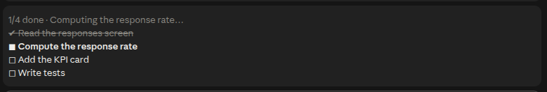
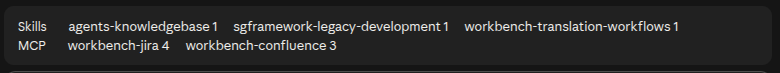

# claude-mods

Two Claude Code mods, installed separately. Both work in the terminal and in the desktop app's Code tab.

| Mod | What it shows |
|---|---|
| [`task-list`](plugins/task-list/README.md) | The session's tasks as a checklist above the prompt |
| [`skill-usage`](plugins/skill-usage/README.md) | The skills and MCP servers used in the session, with a full table in a pane |

### `task-list`



### `skill-usage`



## Prerequisites

- Claude Code **2.1.289** or newer (`claude --version`). Older builds don't load mods; `claude update` fixes that. The desktop app ships its own build, so only a terminal `claude` is likely to be behind.

## Install

Add the marketplace once:

```bash
claude plugin marketplace add vmlinuz82/claude-mods
```

Then install only the mods you want:

```bash
claude plugin install task-list@claude-mods
```

```bash
claude plugin install skill-usage@claude-mods
```

Start a new session (or run `/reload-plugins` in a running one) to see them.

## Updates

**Every push to `main` is a new version** — the mods carry no `version` number, so Claude Code tracks the latest commit instead.

Claude Code doesn't check marketplaces outside Anthropic's for updates unless you turn it on. Turn it on once, either way:

- In Claude Code: `/plugin` → **Marketplaces** → `claude-mods` → **Enable auto-update**
- Or in `~/.claude/settings.json`, add `"autoUpdate": true` to the marketplace entry:

  ```json
  "extraKnownMarketplaces": {
    "claude-mods": {
      "source": { "source": "github", "repo": "vmlinuz82/claude-mods" },
      "autoUpdate": true
    }
  }
  ```

With it on, Claude Code checks a few minutes after your first message in a session and shows `Plugin updated: <name> · Run /reload-plugins to apply`; the new version loads on `/reload-plugins` or the next launch.

Without it, update by hand:

```bash
claude plugin marketplace update claude-mods
```

```bash
claude plugin update task-list@claude-mods
```

```bash
claude plugin update skill-usage@claude-mods
```

## Remove

```bash
claude plugin uninstall task-list@claude-mods
```

## Behaviour worth knowing

- **The two mods share the space above the prompt** — the task list sits on top, the skill usage lines under it.
- **Nothing shows until there's something to show:** the task list only while a task is unfinished, the skill usage band only once a skill or MCP server has been used.
- **If a mod doesn't appear,** run `claude --debug` in a terminal and look for lines starting with `task-list:` or `skill-usage:`; the reason is given there.
