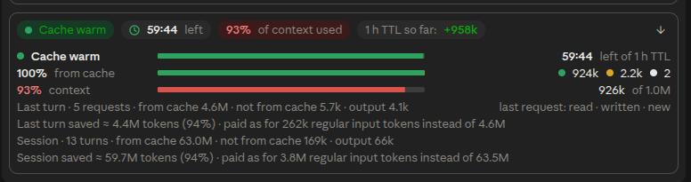

# cache-meter

Shows how long Claude's prompt cache stays warm, how much of each request it served, and what it saved.

Above the prompt, one strip of pills:


The arrow opens the details: a bar for the time left, the mix of the last request (read from cache, written to it, new), the context fill, and a line each for the last turn and the session, with what each saved:



## Install

```bash
claude plugin marketplace add vmlinuz82/claude-mods
```

```bash
claude plugin install cache-meter@claude-mods
```

## What the numbers mean

| Shown | Meaning |
|---|---|
| `Cache warm` / `Cache expired` | Anthropic still holds a copy of the conversation from the last request — green, amber in the last 15% of its lifetime, red once gone |
| `59:15 left` | time until it expires, counted from the start of the last request; every message restarts it |
| `from cache` / `not from cache` | tokens read from the cache (cheap) against those written to it or sent as plain input |
| `saved` | what the cache saved, as many regular input tokens as the difference in the bill would buy |
| `1 h TTL so far` | the one-hour cache against the five-minute one this session: positive once a pause of 5 to 60 minutes was kept, negative while only its dearer writes count |
| `of context used` | the conversation's size against the model's context window — amber from 70%, red from 90% |

**Prices behind the savings**, against regular input tokens: a cache read 0.1× (0.05× on the 5.5 models, 0.025× on Fable and Mythos 5.1), a write 1.25× for five minutes or 2× for an hour, output 5×. The figures compare costs on one scale, they are not a bill.

## Behaviour worth knowing

- **Amber means act now if you will come back:** the pill shows what an expiry would cost and what a short message costs to keep the cache warm — a read of the conversation instead of writing it again.
- The lifetime comes from Claude Code's own settings (`promptCacheTtl`, `CLAUDE_CODE_PROMPT_CACHE_TTL`, `FORCE_PROMPT_CACHING_5M`, `ENABLE_PROMPT_CACHING_1H`), otherwise from its default (an hour on a subscription, five minutes with an API key), and is corrected by what the cache actually does after a pause.
- **The main conversation only:** subagents keep caches of their own and are left out.
- When a turn rebuilds the cache instead of reading it, the details say why: it expired, the model or effort changed, `/compact`, or the cause is unknown.
- On a narrow window the strip leaves out its least important pills instead of wrapping; all the numbers stay in the details.
- Headless `claude -p` runs have nowhere to draw, so the mod shows nothing there.
