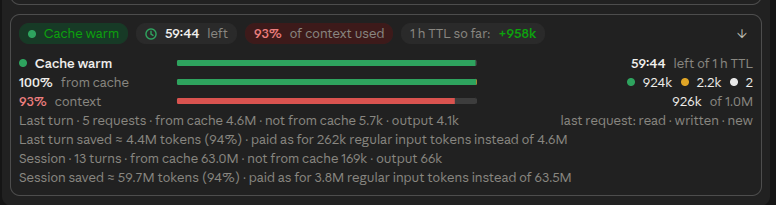

# cache-meter

Shows how long Claude's prompt cache stays warm, how much of each request it served, and what it saved.

Above the prompt, one strip of pills:


The arrow opens the details: a bar for the time left, the mix of the last request (read from cache, written to it, new), the context fill, and a line each for the last turn and the session, with what each saved:



## Install

```bash
claude plugin marketplace add vmlinuz82/claude-mods
```

```bash
claude plugin install cache-meter@claude-mods
```

## What the numbers mean

| Shown | Meaning |
|---|---|
| `Cache warm` / `Cache expired` | Anthropic still holds a copy of the conversation from the last request — green, amber in the last 15% of its lifetime, red once gone |
| `59:15 left` | time until it expires, counted from the start of the last request; every message restarts it |
| `from cache` / `not from cache` | tokens read from the cache (cheap) against those written to it or sent as plain input |
| `saved` | what the cache saved, as many regular input tokens as the difference in the bill would buy |
| `1 h TTL so far` | the one-hour cache against the five-minute one this session: positive once a pause of 5 to 60 minutes was kept, negative while only its dearer writes count |
| `of context used` | the conversation's size against the model's context window — amber from 70%, red from 90% |

**Prices behind the savings**, against regular input tokens: a cache read 0.1× (0.05× on the 5.5 models, 0.025× on Fable and Mythos 5.1), a write 1.25× for five minutes or 2× for an hour, output 5×. The figures compare costs on one scale, they are not a bill.

## Behaviour worth knowing

- **A system notification goes out as the strip turns amber,** once per countdown: 9 minutes before a one-hour cache expires, 45 seconds before a five-minute one. It names the session (its folder until it has a title) and what an expiry would cost. It uses `notify-send` on Linux and `osascript` on macOS; where neither works, the same text shows as a toast in Claude.
- **Keep warm** (the button beside the arrow asks in Claude Code's own question dialog, each pause with what it saves, any other number of hours typed under Other) keeps the cache alive through a pause of 1 to 24 hours: as the strip turns amber it sends `Keep warm, it's cold out here: reply ok, no tools.` into the session, in place of the notification. **Only the pauses whose keep-alives cost less than writing the conversation again are offered,** with the longest one that still pays off. It stops when you send a message of your own, the hours run out or you pick Stop in the dialog; while on, the button shows the time left and the dialog what its keep-alives cost against that rebuild. Each keep-alive shows in the chat as one dim line (the terminal's ctrl+o shows it whole), adds its message and Claude's "ok" to the conversation, a few dozen tokens, and counts towards your usage like any message, and nothing goes out while the machine sleeps.
- **Amber means act now if you will come back:** the pill shows what an expiry would cost and what a short message costs to keep the cache warm — a read of the conversation instead of writing it again.
- The lifetime comes from Claude Code's own settings (`promptCacheTtl`, `CLAUDE_CODE_PROMPT_CACHE_TTL`, `FORCE_PROMPT_CACHING_5M`, `ENABLE_PROMPT_CACHING_1H`), otherwise from its default (an hour on a subscription, five minutes with an API key), and is corrected by what the cache actually does after a pause.
- **The main conversation only:** subagents keep caches of their own and are left out.
- When a turn rebuilds the cache instead of reading it, the details say why: it expired, the model or effort changed, `/compact`, or the cause is unknown.
- On a narrow window the strip leaves out its least important pills instead of wrapping; all the numbers stay in the details.
- Headless `claude -p` runs have nowhere to draw, so the mod shows nothing there.
